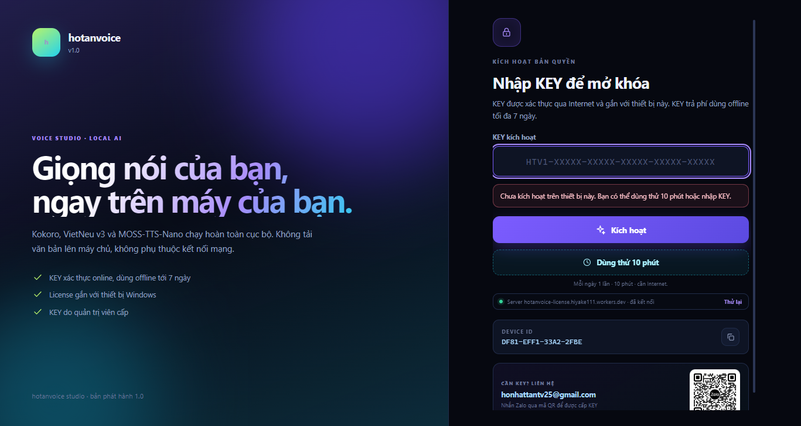
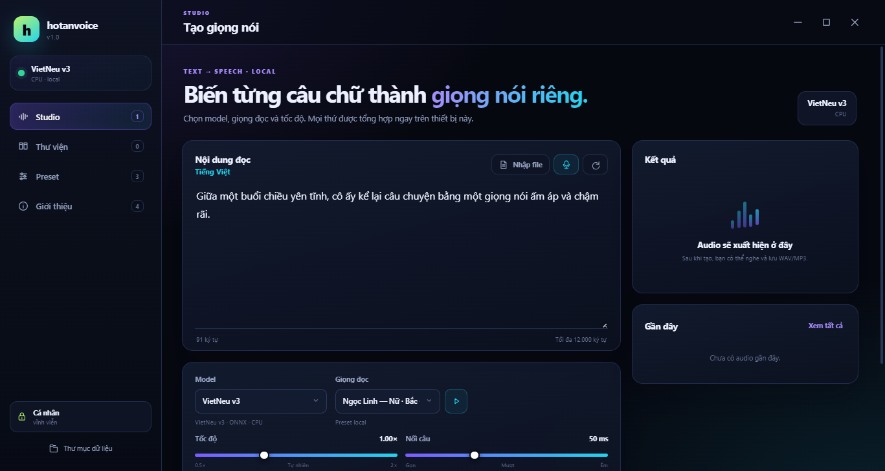
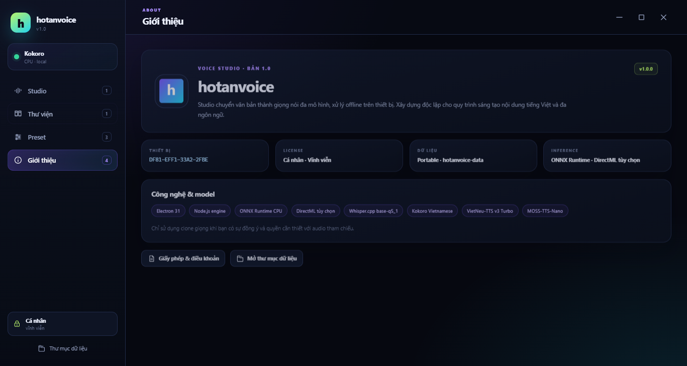
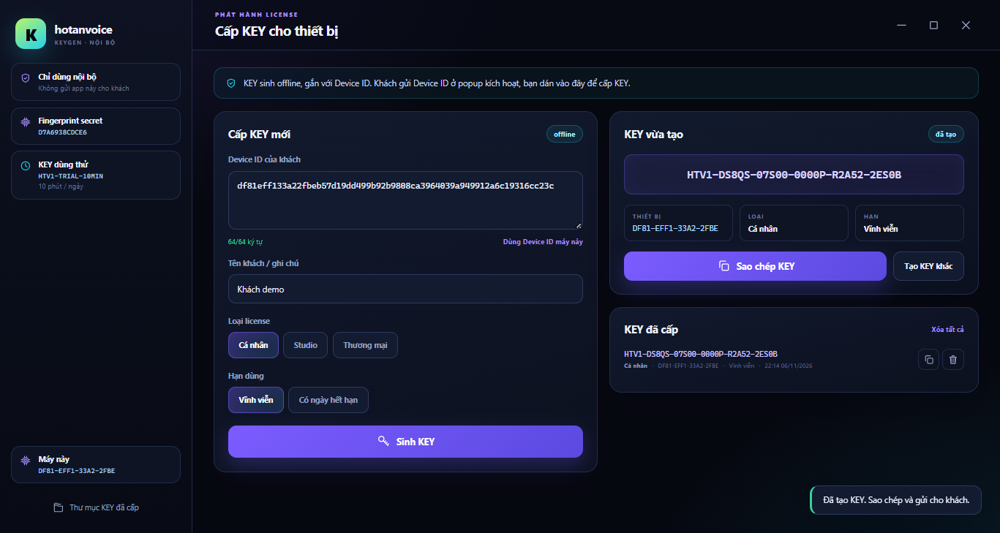

# hotanvoice v1.0

> Studio chuyển văn bản thành giọng nói tiếng Việt, chạy **hoàn toàn trên máy** Windows.
> Không gửi nội dung TTS lên cloud — chỉ license được xác thực qua Internet.



## Điểm chính

- **3 engine TTS tiếng Việt**: Kokoro Vietnamese, VieNeu-TTS v3 Turbo, MOSS-TTS-Nano — chạy local bằng ONNX Runtime.
- **Nhận dạng giọng nói** (Whisper.cpp) để tạo voice/preset từ audio mẫu.
- **Giọng có sẵn + voicepack**: 14 voicepack đóng gói kèm, nghe thử trước khi dùng.
- **Preset & lịch sử**: lưu thiết lập, nghe lại, xuất WAV/MP3.
- **License online gắn thiết bị**: KEY HMAC + lease ECDSA P-256, dùng offline tối đa 7 ngày.
- **Dùng thử 10 phút/ngày**, server quyết định, không cần nhập KEY.

| Studio | Giới thiệu |
| --- | --- |
|  |  |

## Kiến trúc

```
hotanvoice.exe  (Electron 31)
├─ main.js          cửa sổ, IPC, vòng kiểm tra license 60 giây
├─ preload.js       cầu nối API an toàn cho renderer
├─ renderer/        giao diện (HTML/CSS/JS thuần)
├─ lib/license.js   xác thực lease bằng public key ECDSA (nhúng sẵn)
└─ node/            worker TTS/ASR: ONNX Runtime, ffmpeg, G2P
         │  HTTPS (activate / session / trial)
         ▼
Cloudflare Worker  (server/cloudflare)
├─ KV               thiết bị, lượt dùng thử, danh sách thu hồi
├─ LICENSE_SECRET   kiểm tra KEY (HMAC-SHA256, gắn Device ID)
└─ PRIVATE_JWK      ký lease ECDSA P-256 (7 ngày)
```

App khách **không chứa secret**. Kể cả giải nén `app.asar` cũng không sinh được KEY mới.

## Cấu trúc repo

```
.
├─ src/                     mã nguồn app (main, preload, renderer, lib, node, assets)
│  ├─ lib/license.js        client license: activate, trial, lease, grace 7 ngày
│  ├─ node/                 worker TTS/ASR chạy trong Electron main process
│  └─ assets/               icon, previews, voicepack, config model
├─ server/
│  ├─ node/                 server Node.js (VPS / máy local)
│  │  ├─ server.js
│  │  ├─ lib/core.js
│  │  ├─ config.example.json
│  │  └─ public-key.json
│  └─ cloudflare/           Cloudflare Worker + KV (khuyến nghị)
│     ├─ worker.js
│     ├─ wrangler.toml
│     └─ DEPLOY.md
├─ keygen/                  app nội bộ cấp KEY (source, secret đọc từ config)
├─ docs/
│  ├─ BUILD.md
│  ├─ LICENSE-SYSTEM.md
│  ├─ SERVER.md
│  └─ FAQ.md
└─ LICENSE
```

## Yêu cầu hệ thống

| Mục | Tối thiểu | Ghi chú |
| --- | --- | --- |
| Hệ điều hành | Windows 10/11 64-bit | |
| CPU | 4 lõi | TTS chạy CPU |
| RAM | 8 GB | 16 GB nếu dùng MOSS-TTS-Nano |
| Ổ đĩa | ~4 GB | model AI chiếm phần lớn |
| Node.js (dev) | 18+ (khuyến nghị 20) | chỉ cần khi chạy từ source |
| GPU | Không bắt buộc | có thể bật DirectML trong Studio |

## Chạy từ source (dev)

```bash
cd src
npm install
npm start
```

### Model AI không kèm trong repo

Repo chỉ chứa source và asset nhẹ (~16 MB). Để chạy TTS, chép thêm các file sau vào `src/assets/`:

| Đường dẫn | Nội dung |
| --- | --- |
| `src/assets/model/kokoro_vi.onnx` | model Kokoro Vietnamese |
| `src/assets/model/sea_g2p.bin` | từ điển G2P |
| `src/assets/model/vieneu-v3-int8/` | VieNeu-TTS v3 Turbo (ONNX + tokenizer + voices) |
| `src/assets/model/moss-tts-nano/` | MOSS-TTS-Nano (ONNX + tokenizer) |
| `src/assets/model/moss-onnx/` | codec cho MOSS |
| `src/assets/asr/` | Whisper.cpp runtime + model |
| `src/assets/ffmpeg/` | ffmpeg.exe để xuất MP3 |

Các thư mục `moss-*/`, `vieneu-*/`, `asr/`, `ffmpeg/` đã nằm trong `.gitignore`.

## Build bản portable

1. Tải **Electron v31.7.7 win32-x64**.
2. Giải nén vào thư mục `app/`.
3. Đổi `electron.exe` → `hotanvoice.exe`.
4. Chép source:

   ```powershell
   robocopy src app\resources\app /E /MT:16
   Copy-Item src\license-server.json app\license-server.json
   ```

5. (Tùy chọn) đổi icon bằng `rcedit`, rồi đóng ZIP phân phối.

Chi tiết: [docs/BUILD.md](docs/BUILD.md).

## Hệ thống license

- KEY dạng `HTV1-XXXXX-XXXXX-XXXXX-XXXXX-XXXXX`, gắn với **Device ID** (64 hex).
- KEY chứa `device code (8) + hạn dùng (6) + gói (1) + chữ ký HMAC (10)`.
- Server kiểm tra KEY bằng `LICENSE_SECRET` rồi cấp **lease ECDSA P-256** hạn 7 ngày.
- App xác thực lease bằng public key nhúng sẵn → không sửa được file cache, không copy sang máy khác.
- KEY trả phí: online lần đầu, sau đó offline tối đa 7 ngày.
- Dùng thử: 10 phút/ngày, luôn cần Internet, không cần KEY.
- Thu hồi KEY: có hiệu lực ở lần heartbeat kế tiếp (tối đa 60 giây khi app đang mở).

Chi tiết: [docs/LICENSE-SYSTEM.md](docs/LICENSE-SYSTEM.md).

## Server license

Khuyến nghị **Cloudflare Worker + KV** (miễn phí, chạy 24/7, không cần VPS):

```bash
cd server/cloudflare
npx wrangler kv namespace create HTV   # chép id vào wrangler.toml
npx wrangler secret put ADMIN_TOKEN
npx wrangler secret put LICENSE_SECRET
npx wrangler secret put PRIVATE_JWK
npx wrangler deploy
```

Sau khi có URL, cập nhật `src/license-server.json`:

```json
{ "url": "https://hotanvoice-license.<tài-khoản>.workers.dev" }
```

Hướng dẫn đầy đủ: [server/cloudflare/DEPLOY.md](server/cloudflare/DEPLOY.md) và [docs/SERVER.md](docs/SERVER.md).

## Cấp KEY cho khách



1. Khách mở app → copy **Device ID** (64 ký tự) trong popup.
2. Chạy `keygen` (app nội bộ, **không phát hành**):
   ```bash
   cd keygen
   copy config.example.json config.json   # rồi điền licenseSecret
   npm install
   npm start
   ```
3. Dán Device ID → chọn gói (Cá nhân / Studio / Thương mại) → chọn hạn → **Sinh KEY**.
4. Gửi KEY cho khách.

`keygen/config.json` chứa `LICENSE_SECRET` nên đã bị `.gitignore`. Không commit, không gửi cho khách.

## Bảo mật

- Repo **không chứa** `LICENSE_SECRET`, `PRIVATE_JWK`, `ADMIN_TOKEN`.
- Nếu lộ secret: đổi `LICENSE_SECRET` trên server + keygen, deploy lại → toàn bộ KEY cũ mất hiệu lực.
- Nếu lộ private key ký lease: tạo cặp ECDSA mới, đổi `PRIVATE_JWK`, cập nhật public key trong `src/lib/license.js`, build lại app.
- Phát hiện lỗi bảo mật: gửi email riêng, không mở issue công khai.
## cảm ơn 
- chân thành cảm ơn sụ ủng hộ và hỗ trợ của : https://github.com/Namtran592005

## Liên hệ

- Gmail: <honhattantv25@gmail.com>


## Giấy phép

Phần mềm thuộc bản quyền của tác giả — xem [LICENSE](LICENSE).
Thành phần bên thứ ba (Electron, ONNX Runtime, ffmpeg, Whisper.cpp, các model TTS)
theo giấy phép riêng của chúng — xem [src/LEGAL-NOTICES.txt](src/LEGAL-NOTICES.txt).
